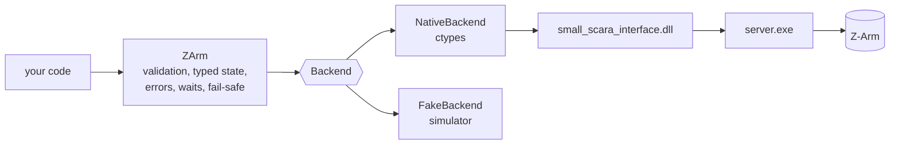

# zarm-sdk

A typed Python SDK for the Hitbot Z-Arm (about 2019, generation 1: two 200 mm links, 310 mm Z travel
and a wrist). It's a thin layer over Hitbot's own native library, `small_scara_interface.dll`. It
doesn't reimplement the controller protocol.

> **Status.** The SDK runs fully against its simulator. The native path loads and binds the DLL,
> but nothing in this repository has driven a real arm yet. The first hardware run should be the
> [smoke test](#hardware-smoke-test), with someone at the emergency stop.

## Why a wrapper, and not an existing SDK

We found no official, pip-installable Hitbot Python SDK and no Hitbot-run GitHub organisation.
What exists is an informal ctypes class, `HitbotInterface`, that ships with the vendor package and
is copied around in projects such as
[cwsfa/hitbot-api](https://github.com/cwsfa/hitbot-api) (Linux `.so`, Apache-2.0),
[jjh1214/hitbot](https://github.com/jjh1214/hitbot) (ROS 2, MIT) and
[PKUAILab/Arm-camera-Hand-eye-Calibration](https://github.com/PKUAILab/Arm-camera-Hand-eye-Calibration)
(Windows). Those classes are untyped, hand back raw result codes, expose `wait_stop` (which never
times out), and at least one passes `z_trail` with the wrong C type for the DLL in this repository.

This SDK binds the x64 DLL that's already in this repository's legacy folders. Its signatures
were read out of that build by static disassembly; see [docs/native-api.md](docs/native-api.md)
for what is verified and what is inferred.

## Requirements

* Python 3.8 or later, standard library only. Tested on 3.9, 3.11 and 3.12.
* For a real arm: Windows, **64-bit** Python, and the Hitbot vendor directory (below).
* The simulator runs anywhere.

```powershell
cd zarm-sdk
py -3.12 -m unittest discover -s tests -t .     # run the tests
py -3.12 -m pip install -e .                     # optional: install the package
```

## Quick start (simulator)

```python
from zarm import CartesianPose, JointPositions, ZArm, ZArmConfig

with ZArm.simulated(ZArmConfig(card_id=59)) as arm:
    arm.connect()
    arm.initialize()
    arm.move_joints(JointPositions(j1_deg=30, j2_deg=45, j3_mm=-50, j4_deg=0), speed=50)
    arm.move_linear(CartesianPose(x_mm=250, y_mm=100, z_mm=-50, r_deg=0), speed_mm_s=50)
    print(arm.get_state())
```

For deterministic tests, pass a `ManualClock` as both clock and sleep:
`clock = ManualClock(); ZArm.simulated(config, clock=clock, sleep=clock.sleep)`.

## A real arm

**The vendor directory** must contain these three files side by side. The DLL loads `share.dll` and
starts `server.exe` from its own directory.

| File | Role |
|---|---|
| `small_scara_interface.dll` | the C API the SDK binds (x64 build) |
| `share.dll` | shared memory between the DLL and the server |
| `server.exe` | TCP server the arm connects to; `net_port_initial` starts it |

A complete x64 set is already in this repository at `Z-Arm Sliders/Z-Arm Sliders/Lib/` (moving to
`legacy/csharp/Z-Arm Sliders/Z-Arm Sliders/Lib/`). Hitbot's binaries have no published license, so
don't add more copies to the repository. Point the SDK at that folder, or at a local copy outside
version control. (`zarm-sdk/.gitignore` ignores `vendor/`, `*.dll` and `*.exe`.)

**Network**: set the PC's Ethernet adapter to `192.168.0.100` (mask `255.255.255.0`), as the legacy
README describes, and allow `server.exe` through the Windows Firewall when prompted.

```python
from zarm import JointPositions, ZArm, ZArmConfig

lib = r"C:\path\to\Z-Arm\Z-Arm Sliders\Z-Arm Sliders\Lib"
with ZArm.native(lib, ZArmConfig(card_id=59)) as arm:   # 59 is the id the legacy code used
    arm.connect()       # starts server.exe if needed, waits for the arm
    arm.initialize()    # vendor initialization: energizes the arm
    arm.move_joints(JointPositions(0, 0, -20, 0), speed=20)
```

`NativeBackend` runs static preflight checks before loading anything: the three files are present,
their SHA-256 hashes match the set whose signatures were verified (listed in
[docs/native-api.md](docs/native-api.md)), the DLL is x64 with the required exports, the path is
short ASCII, and Python is 64-bit. Only one `NativeBackend` can be active per process, because the
DLL keeps process-wide state.

## Units and joints

Units are part of every name, and they're the vendor's own units, so nothing is converted at the
boundary. `to_si()` converts to radians and metres when you need them.

| Joint | Kind | Field | Unit | Vendor name | Default soft limits |
|---|---|---|---|---|---|
| J1 shoulder | revolute | `j1_deg` | deg | `angle1` | -90 to 90 |
| J2 elbow | revolute | `j2_deg` | deg | `angle2` | -164 to 164 |
| J3 vertical | prismatic | `j3_mm` | mm (0 at the top, negative down) | `z` | -310 to 0 |
| J4 wrist | revolute | `j4_deg` | deg | `r` | -180 to 180 |

The default soft limits are the slider ranges from the legacy *Z-Arm Sliders* app; override them
with `ZArmConfig(joint_limits=JointLimits(...))`. Cartesian poses are `CartesianPose(x_mm, y_mm, z_mm,
r_deg)`. The vendor uses the same `r` in joint and Cartesian commands; legacy code hints that it's
the tool's rotation in the base frame rather than relative to the forearm (unverified).

Speeds: for joint-interpolated moves (`move_joints`, `move_to_pose`, `change_hand`) `speed` is in deg/s
for J1, J2 and J4 and mm/s for J3, and the slowest joint sets the duration (per the vendor header).
`move_linear` takes `speed_mm_s`. `ZArmConfig` caps both at 100 by default.

## API

| Area | `ZArm` methods |
|---|---|
| Lifecycle | `connect(timeout_s)`, `initialize(attempts, retry_delay_s)`, `close(stop_server=False)`, context manager |
| State | `get_state()` → `ArmState`, `get_encoder_reading()`, `get_joint_state(joint)`, `get_joint_states()`, `is_moving()`, `is_collision()` |
| Motion | `move_joints(target, speed, roughly, wait, timeout_s)`, `move_to_pose(target, speed, roughly, lr, wait, timeout_s)`, `move_linear(target, speed_mm_s, wait, timeout_s)`, `change_hand(speed)`, `wait_until_stopped(timeout_s)` |
| Stopping | `stop()`, `emergency_stop()`, `pause()`, `resume()` |
| Homing | `start_homing(joint)`: the joint moves and the arm is de-initialized; wait, then `initialize()` again |
| Modes and I/O | `set_drag_teach()`, `get_drag_teach()`, `set_cooperation_mode()`, `get_cooperation_mode()`, `read_digital_input(io)`, `read_digital_output(io)`, `write_digital_output(io, on)` |

Vendor result codes become enums (`InitResult`, `MoveResult`, `JointState`, `ConnectStatus`,
`HomeResult`) and typed exceptions under `ZArmError`. For example, `MoveResult.COLLISION` raises
`CollisionError`, and a timed-out wait raises `MotionTimeoutError`. Unknown codes stay plain ints;
they aren't forced into an enum.

## Safety behaviour

* **Single owner.** One `ZArm` per arm per backend; a second one gets `OwnershipError`.
* **Timeouts on every wait.** Motion waits default to 2 × the estimated duration + 3 s, capped at
  `max_motion_timeout_s` (300 s). Arm discovery, initialization retries and `wait_until_stopped` are
  bounded too. The SDK never calls the vendor's `robot_wait_stop`, which has no timeout.
* **Fail-safe stop.** From the moment a command may have reached the arm until its wait ends, any
  exception sends `robot_stop_move` before it propagates: a rejected command, a timeout, a
  collision, lost communication, non-finite telemetry, the arm leaving the soft limits or stopping
  short of its target, and Ctrl+C. The same applies to `initialize()`, `start_homing()`, `pause()`
  and `resume()`. `stop()` can be called from another thread while a move is waiting.
* **Closing.** `close()` sends a stop at once, without waiting for a command in progress (one might
  be stuck behind a vendor message box). It sends a second stop once in-progress commands finish,
  so a command that slipped in between is stopped too, then releases the arm. Interpreter exit
  stops every open arm. Several `ZArm`s can share one backend and its vendor server: each holds a
  lease, `close(stop_server=True)` shuts the server down only when the last lease goes (atomically),
  and a backend created by `ZArm.native()` closes when its last user does.
* **Checked before sending.** Rejected locally, before anything reaches the arm:
  * non-finite numbers, and values that don't fit the C types (ctypes would silently turn `2**32`
    into 0 or `1e300` into infinity);
  * speeds above the caps, `roughly` outside [0, 1] (the DLL returns garbage for it), `lr` other
    than -1, 0 or 1, I/O numbers above 63 and card ids outside 0..255 (the DLL doesn't
    bounds-check them);
  * soft-limit and reach violations. These are checked for joint targets; for Cartesian targets,
    using the J1/J2 solution in the current hand (both hands when `lr` is given); along the whole
    path of a linear move; and for the target of `change_hand`.
* **Watched during motion.** While waiting, the SDK stops the arm (`LimitExceededError`) if any
  joint moves further outside the soft limits than it started. That check doesn't depend on the
  kinematic conventions the pre-checks assume.
* **Arrival is checked.** A move that ends away from its target raises `MotionIncompleteError`,
  except with `roughly > 0`, which allows blending.
* **What the SDK can't fix.** The vendor DLL can show modal message boxes (server start timeout,
  joint faults) that block the calling thread until dismissed. `emergency_stop()`'s effect on the
  servos is unverified. **The hardware E-stop is the real safety layer.**

## Architecture



`Backend` (in `zarm/backend.py`) has one method per vendor function, in vendor units and with raw
result codes. `FakeBackend` follows the DLL's check order and result codes. It raises
`FakeBackendMisuseError` wherever the real DLL would crash, for example a `robot_*` call before
`net_port_initial`. That makes the unit tests a check on SDK behaviour against the real library's
rules.

## Hardware smoke test

`scripts/hardware_smoke_test.py` is opt-in and refuses to run without explicit flags. Each hardware
step needs its own flag, and every hardware step needs `--i-am-at-the-estop` and `--card-id`. Hardware
steps only run against the verified vendor set. Before any motion, the script checks that both the
outbound target and the return position are within the soft limits.

```powershell
# Static checks only: touches nothing
py -3.12 scripts\hardware_smoke_test.py --library-dir "..\Z-Arm Sliders\Z-Arm Sliders\Lib" --preflight-only

# Connect and read state (no motion)
py -3.12 scripts\hardware_smoke_test.py --library-dir "..\Z-Arm Sliders\Z-Arm Sliders\Lib" --card-id 59 --i-am-at-the-estop --connect

# Also initialize, then rotate J4 by 5 degrees and back at 10 deg/s (asks you to type MOVE)
py -3.12 scripts\hardware_smoke_test.py --library-dir "..\Z-Arm Sliders\Z-Arm Sliders\Lib" --card-id 59 --i-am-at-the-estop --connect --initialize --allow-motion
```

## Open questions

These need the arm (or Hitbot's documentation) to settle:

1. Is the arm's card id still 59?
2. What does `robot_emergency_stop` do to the servos, and how do you recover from it?
3. Which `lr` value selects which hand in `move_to_pose(..., lr=...)`? The SDK accepts only -1, 0
   and 1 until this is known.
4. Is `r` the tool's absolute rotation or J4 relative to the forearm?
5. Are the speed units for joint moves really deg/s and mm/s, and what are the arm's maximum speeds?
6. Does `robot_joint_home` set the moving flag while homing, so that `wait_until_stopped()` can detect completion?
7. Do the controller's angle conventions match `zarm/kinematics.py` (J1 = J2 = 0 extends the arm
   along +X; counter-clockwise is positive)? The Cartesian soft-limit pre-checks assume they do.
   The runtime envelope check doesn't depend on it.
8. What do digital input levels mean electrically, and what are the gripper (`efg`) calls for?
9. Can the modal message boxes be avoided? Running the vendor DLL in a separate worker process would
   at least keep them from blocking the controlling program.
