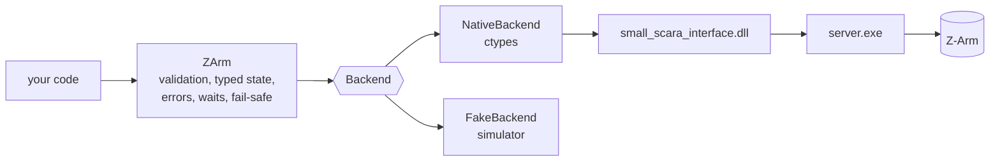

# zarm-sdk

A typed Python SDK for the Hitbot Z-Arm (about 2019, generation 1; assumed to be a Z-Arm 2442 with
220 mm and 200 mm links, 310 mm of Z travel and a wrist). It's a thin layer over Hitbot's own native
library, `small_scara_interface.dll`. It doesn't reimplement the controller protocol.

> **Status.** The SDK runs fully against its simulator. The native path loads and binds the DLL,
> but nothing in this repository has driven a real arm yet. Where the hardware's behaviour is
> unknown, the SDK and the simulator follow documented
> [default assumptions](#default-assumptions-unverified-on-hardware). The first hardware run should
> be the [smoke test](#hardware-smoke-test), with someone at the emergency stop.

## Why a wrapper, and not an existing SDK

We found no official, pip-installable Hitbot Python SDK and no Hitbot-run GitHub organisation.
What exists is an informal ctypes class, `HitbotInterface`, that ships with the vendor package and
is copied around in projects such as
[cwsfa/hitbot-api](https://github.com/cwsfa/hitbot-api) (Linux `.so`, Apache-2.0),
[jjh1214/hitbot](https://github.com/jjh1214/hitbot) (ROS 2, MIT) and
[PKUAILab/Arm-camera-Hand-eye-Calibration](https://github.com/PKUAILab/Arm-camera-Hand-eye-Calibration)
(Windows). Those classes are untyped, hand back raw result codes, expose `wait_stop` (which never
times out), and at least one passes `z_trail` with the wrong C type for the DLL in this repository.

This SDK binds the x64 DLL that's already in this repository's legacy folders. Its signatures
were read out of that build by static disassembly; see [docs/native-api.md](docs/native-api.md)
for what is verified and what is inferred.

## Requirements

* Python 3.8 or later, standard library only. Tested on 3.9, 3.11 and 3.12.
* For a real arm: Windows, **64-bit** Python, and the Hitbot vendor directory (below).
* The simulator runs anywhere.

```powershell
cd zarm-sdk
py -3.12 -m unittest discover -s tests -t .     # run the tests
py -3.12 -m pip install -e .                     # optional: install the package
```

## Quick start (simulator)

```python
from zarm import CartesianPose, JointPositions, ZArm, ZArmConfig

with ZArm.simulated(ZArmConfig(card_id=59)) as arm:
    arm.connect()
    arm.initialize()
    arm.move_joints(JointPositions(j1_deg=30, j2_deg=45, j3_mm=-50, j4_deg=0), speed=50)
    arm.move_linear(CartesianPose(x_mm=250, y_mm=100, z_mm=-50, r_deg=0), speed_mm_s=50)
    print(arm.get_state())
```

For deterministic tests, pass a `ManualClock` as both clock and sleep:
`clock = ManualClock(); ZArm.simulated(config, clock=clock, sleep=clock.sleep)`. The simulated arm
uses `config.arm_lengths_mm` (220 mm and 200 mm by default), and the rated joint ranges are its hard
limits.

## A real arm

**The vendor directory** must contain these three files side by side. The DLL loads `share.dll` and
starts `server.exe` from its own directory.

| File | Role |
|---|---|
| `small_scara_interface.dll` | the C API the SDK binds (x64 build) |
| `share.dll` | shared memory between the DLL and the server |
| `server.exe` | TCP server the arm connects to; `net_port_initial` starts it |

A complete x64 set is already in this repository at `Z-Arm Sliders/Z-Arm Sliders/Lib/` (moving to
`legacy/csharp/Z-Arm Sliders/Z-Arm Sliders/Lib/`). Hitbot's binaries have no published license, so
don't add more copies to the repository. Point the SDK at that folder, or at a local copy outside
version control. (`zarm-sdk/.gitignore` ignores `vendor/`, `*.dll` and `*.exe`.)

**Network**: set the PC's Ethernet adapter to `192.168.0.100` (mask `255.255.255.0`), as the legacy
README describes, and allow `server.exe` through the Windows Firewall when prompted.

```python
from zarm import JointPositions, ZArm, ZArmConfig

lib = r"C:\path\to\Z-Arm\Z-Arm Sliders\Z-Arm Sliders\Lib"
with ZArm.native(lib, ZArmConfig(card_id=59)) as arm:   # 59: the id the legacy code used (assumed)
    arm.connect()       # starts server.exe if needed, waits for the arm
    arm.initialize()    # vendor initialization: energizes the arm
    arm.move_joints(JointPositions(0, 0, -20, 0), speed=20)
```

`NativeBackend` runs static preflight checks before loading anything: the three files are present,
their SHA-256 hashes match the set whose signatures were verified (listed in
[docs/native-api.md](docs/native-api.md)), the DLL is x64 with the required exports, the path is
short ASCII, and Python is 64-bit. Only one `NativeBackend` can be active per process, because the
DLL keeps process-wide state.

## Units and joints

Units are part of every name, and they're the vendor's own units, so nothing is converted at the
boundary. `to_si()` converts to radians and metres when you need them.

| Joint | Kind | Field | Unit | Vendor name | Default soft limits | Rated (2442) |
|---|---|---|---|---|---|---|
| J1 shoulder | revolute | `j1_deg` | deg | `angle1` | -90 to 90 | ±90 |
| J2 elbow | revolute | `j2_deg` | deg | `angle2` | -164 to 164 | ±164 |
| J3 vertical | prismatic | `j3_mm` | mm (0 at the top, negative down) | `z` | -310 to 0 | 310 mm stroke |
| J4 wrist | revolute | `j4_deg` | deg | `r` | -180 to 180 | ±1080 |

The default soft limits are the slider ranges from the legacy *Z-Arm Sliders* app; override them
with `ZArmConfig(joint_limits=JointLimits(...))`, and `JointLimits.rated()` gives the rated ranges.
Cartesian poses are `CartesianPose(x_mm, y_mm, z_mm, r_deg)`. The vendor uses the same `r` in joint
and Cartesian commands. It's assumed to be the J4 joint angle relative to the forearm, not the tool's
yaw in the base frame; that yaw is J1 + J2 + r (`zarm.kinematics.tool_yaw_deg`). See
[assumption 4](#4-r-is-the-j4-joint-angle-relative-to-the-forearm).

Speeds: for joint-interpolated moves (`move_joints`, `move_to_pose`, `change_hand`) `speed` is in deg/s
for J1, J2 and J4 and mm/s for J3, and the slowest joint sets the duration (per the vendor header).
`move_linear` takes `speed_mm_s`. `ZArmConfig` caps both at 100 by default
([assumption 5](#5-speeds-are-degs-and-mms)).

## API

| Area | `ZArm` methods |
|---|---|
| Lifecycle | `connect(timeout_s)`, `initialize(attempts, retry_delay_s)`, `close(stop_server=False)`, context manager |
| State | `get_state()` → `ArmState`, `get_encoder_reading()`, `get_joint_state(joint)`, `get_joint_states()`, `is_moving()`, `is_collision()` |
| Motion | `move_joints(target, speed, roughly, wait, timeout_s)`, `move_to_pose(target, speed, roughly, lr, wait, timeout_s)`, `move_linear(target, speed_mm_s, wait, timeout_s)`, `change_hand(speed)`, `wait_until_stopped(timeout_s)` |
| Stopping | `stop()`, `emergency_stop()` (assumed to latch: `initialize()` again afterwards), `pause()`, `resume()` |
| Homing | `start_homing(joint)`, then `wait_for_homing(timeout_s)`, then `initialize()`: the joint moves, and the vendor de-initializes the arm |
| Modes and I/O | `set_drag_teach()`, `get_drag_teach()`, `set_cooperation_mode()`, `get_cooperation_mode()`, `read_digital_input(io)`, `read_digital_output(io)`, `write_digital_output(io, on)` |

Vendor result codes become enums (`InitResult`, `MoveResult`, `JointState`, `ConnectStatus`,
`HomeResult`) and typed exceptions under `ZArmError`. For example, `MoveResult.COLLISION` raises
`CollisionError`, and a timed-out wait raises `MotionTimeoutError`. Unknown codes stay plain ints;
they aren't forced into an enum.

## Safety behaviour

* **Single owner.** One `ZArm` per arm per backend; a second one gets `OwnershipError`.
* **Timeouts on every wait.** Motion waits default to 2 × the estimated duration + 3 s, capped at
  `max_motion_timeout_s` (300 s). Arm discovery, initialization retries, `wait_until_stopped` and
  `wait_for_homing` are bounded too. The SDK never calls the vendor's `robot_wait_stop`, which has no
  timeout.
* **Fail-safe stop.** From the moment a command may have reached the arm until its wait ends, any
  exception sends `robot_stop_move` before it propagates: a rejected command, a timeout, a
  collision, lost communication, non-finite telemetry, the arm leaving the soft limits or stopping
  short of its target, and Ctrl+C. The same applies to `initialize()`, `start_homing()`,
  `wait_for_homing()`, `pause()` and `resume()`. `stop()` can be called from another thread while a
  move is waiting.
* **Initialization is tracked.** Motion needs `initialize()` first, and again after homing and after
  `emergency_stop()`. If the controller reports itself uninitialized (vendor code 3, or its flag
  dropping during a wait), the SDK agrees and stops the arm.
* **Closing.** `close()` sends a stop at once, without waiting for a command in progress (one might
  be stuck behind a vendor message box). It sends a second stop once in-progress commands finish,
  so a command that slipped in between is stopped too, then releases the arm. Interpreter exit
  stops every open arm. Several `ZArm`s can share one backend and its vendor server: each holds a
  lease, `close(stop_server=True)` shuts the server down only when the last lease goes (atomically),
  and a backend created by `ZArm.native()` closes when its last user does.
* **Checked before sending.** Rejected locally, before anything reaches the arm:
  * non-finite numbers, and values that don't fit the C types (ctypes would silently turn `2**32`
    into 0 or `1e300` into infinity);
  * speeds above the caps, `roughly` outside [0, 1] (the DLL returns garbage for it), `lr` other
    than -1, 0 or 1, I/O numbers above 63 and card ids outside 0..255 (the DLL doesn't
    bounds-check them);
  * soft-limit and reach violations. These are checked for joint targets; for Cartesian targets,
    using the J1/J2 solution in the current hand (both hands when `lr` is given); along the whole
    path of a linear move; and for the target of `change_hand`.
* **Watched during motion.** While waiting, the SDK stops the arm (`LimitExceededError`) if any
  joint moves further outside the soft limits than it started. That check doesn't depend on the
  kinematic conventions the pre-checks assume.
* **Arrival is checked.** A move that ends away from its target raises `MotionIncompleteError`,
  except with `roughly > 0`, which allows blending.
* **What the SDK can't fix.** The vendor DLL can show modal message boxes (server start timeout,
  joint faults) that block the calling thread until dismissed; the planned control server will run it
  in a worker process ([assumption 9](#9-the-vendor-dll-will-run-in-a-worker-process)). What
  `emergency_stop()` does to the servos is unverified. **The hardware E-stop is the real safety
  layer.**

## Architecture



`Backend` (in `zarm/backend.py`) has one method per vendor function, in vendor units and with raw
result codes. `FakeBackend` follows the DLL's check order and result codes. It raises
`FakeBackendMisuseError` wherever the real DLL would crash, for example a `robot_*` call before
`net_port_initial`. That makes the unit tests a check on SDK behaviour against the real library's
rules. Where the real library's behaviour isn't known, `FakeBackend` follows the default assumptions
below.

## Hardware smoke test

`scripts/hardware_smoke_test.py` is opt-in and refuses to run without explicit flags. Each hardware
step needs its own flag, and every hardware step needs `--i-am-at-the-estop` and `--card-id`. Hardware
steps only run against the verified vendor set. Before any motion, the script checks that both the
outbound target and the return position are within the soft limits. After connecting, it compares
the vendor's reported (x, y) with `forward_xy` for both `arm_lengths_mm` and `vendor_arm_lengths_mm`,
a read-only check of [assumption 7](#7-kinematics-a-z-arm-2442-with-220-mm-and-200-mm-links).

```powershell
# Static checks only: touches nothing
py -3.12 scripts\hardware_smoke_test.py --library-dir "..\Z-Arm Sliders\Z-Arm Sliders\Lib" --preflight-only

# Connect and read state (no motion)
py -3.12 scripts\hardware_smoke_test.py --library-dir "..\Z-Arm Sliders\Z-Arm Sliders\Lib" --card-id 59 --i-am-at-the-estop --connect

# Also initialize, then rotate J4 by 5 degrees and back at 10 deg/s (asks you to type MOVE)
py -3.12 scripts\hardware_smoke_test.py --library-dir "..\Z-Arm Sliders\Z-Arm Sliders\Lib" --card-id 59 --i-am-at-the-estop --connect --initialize --allow-motion
```

## Default assumptions (unverified on hardware)

The arm is in storage, so none of these has been checked on it. The SDK and the simulator are built
on them. Each entry gives the evidence and says how to override the assumption if the hardware
disagrees. Checking them is the first job once the arm is back; the smoke test's `--connect` step
already reports on assumption 7.

### 1. The arm's card id is 59

* **Evidence:** the legacy C# code connects to card 59 (`new ZArm(59)` and `get_robot(59)` in
  `ZArm Class Framework/ZArm Class Framework/Program.cs`). It's available as `zarm.LEGACY_CARD_ID`.
* **In the code:** nothing depends on it. `ZArmConfig.card_id` defaults to `None`, which discovers
  the one connected arm and refuses to guess between several. The smoke test requires `--card-id`.
* **Override:** `ZArmConfig(card_id=...)`.

### 2. `emergency_stop()` latches

* **Assumption:** after `robot_emergency_stop` the arm stays uninitialized until `initialize()`
  succeeds again.
* **Evidence:** nothing direct. The DLL's `emergency_stop` starts a detached thread whose effect
  wasn't traced. Latching is the usual behaviour of an emergency stop and the safe thing to assume.
* **In the code:** `ZArm.emergency_stop()` drops the arm to the `CONNECTED` phase, so motion is
  refused until `initialize()`. `FakeBackend.emergency_stop` clears its initialized flag.
* **Override:** none needed. If the stop doesn't latch, the only cost is an extra `initialize()`.

### 3. `lr` selects the hand by the sign of J2

* **Assumption:** in `move_to_pose(..., lr=...)`, 1 selects the hand with J2 ≥ 0, -1 the hand with
  J2 ≤ 0, and 0 keeps the current hand.
* **Evidence:** none. The DLL passes `lr` into its inverse kinematics and returns 7 when the target
  is unreachable in that hand; which value means which hand isn't known.
* **In the code:** `FakeBackend.movej_xyz_lr` follows the convention. Because it's a guess,
  `move_to_pose` checks both hand solutions against the soft limits when `lr` is given, so a wrong
  guess can't take the arm outside them.
* **Override:** if the hardware has the opposite mapping, pass the other sign (and change
  `FakeBackend.movej_xyz_lr` to match).

### 4. `r` is the J4 joint angle relative to the forearm

* **Assumption:** in joint and Cartesian commands alike, `r` is J4's own angle. The tool's yaw in the
  base frame is then J1 + J2 + r (`zarm.kinematics.tool_yaw_deg`).
* **Evidence:** the vendor header copy in this repository (`ScaraTesting/ScaraMockDll/Scara.h`) calls
  `rotation` the "angle value of joint 4" in `get_scara_param`, `set_angle_move` and the Cartesian
  `set_position_move`. [jjh1214/hitbot_sim](https://github.com/jjh1214/hitbot_sim), which drove a
  real Z-Arm from a URDF, passes the URDF wrist joint angle straight through as `r`
  (`new_movej_angle(j2, j3, z_mm, joint4_deg, ...)`). Against it: the legacy *Z-Arm Sliders* pipe
  handler sent shoulder + elbow + wrist as the rotation, but that was untested code fed by a Unity
  client whose wrist convention isn't known.
* **In the code:** `CartesianPose.r_deg` and `JointPositions.j4_deg` carry the same value. The
  simulator treats `r` as J4 in every command, so `change_hand()` keeps J4 and the tool's yaw changes.
* **Override:** if `r` turns out to be the absolute yaw, convert with `r = yaw - J1 - J2` before
  Cartesian commands.

### 5. Speeds are deg/s and mm/s

* **Assumption:** joint moves take deg/s for J1, J2 and J4 and mm/s for J3, with the slowest joint
  setting the duration; linear moves take mm/s. `move_to_pose` (`robot_movej_xyz`) is taken to use
  the joint speed, like `move_joints`.
* **Evidence:** the vendor header gives deg/s (axes 1, 2 and 4) and mm/s (axis 3) for single-axis
  moves, deg/s for `change_attitude`, and per-joint timing for `set_angle_move` (each joint's
  difference divided by the speed). It gives mm/s for `set_position_move` in both of its modes, which
  makes `move_to_pose`'s unit the least certain. Hitbot rates the
  [Z-Arm 2442E](https://www.hitbotrobot.com/product/robotic-arm-z-arm-2442e/) at up to 1220 mm/s with
  a 2 kg load.
* **In the code:** `max_joint_speed` and `max_linear_speed_mm_s` stay at a conservative 100.
* **Override:** `ZArmConfig(max_joint_speed=..., max_linear_speed_mm_s=...)`.

### 6. Homing doesn't set the moving flag

* **Evidence:** none either way. The legacy code never polled the flag after `joint_home`; it waited
  fixed times instead (3 s before `initial()`, or 10 to 15 s through `ZArm.GoHome`, all in the
  `ZArm Class Framework` project).
* **In the code:** `wait_for_homing()` watches the joint positions rather than the flag. It returns
  once nothing has moved by more than `tolerance` for `settle_s` and at least `min_wait_s` (3 s) has
  passed, and it's bounded by `timeout_s`. If the flag is set, it only extends the wait.
  `initialize()` and another `start_homing()` are refused until `wait_for_homing()` succeeds. The
  simulator homes without setting the flag, and its `initial()` returns 3 during homing, as the
  legacy notes saw.
* **Override:** none needed, since the wait works whether or not the flag is set. Tune `settle_s`,
  `min_wait_s` and `tolerance` if real homing is slower or noisier.

### 7. Kinematics: a Z-Arm 2442 with 220 mm and 200 mm links

* **Assumption:** J1 = J2 = 0 extends the arm along +X; counter-clockwise, seen from above, is
  positive; Z is 0 at the top of travel and negative going down. The J1 link is 220 mm and the J2
  link 200 mm.
* **Evidence:** Hitbot's [Z-Arm 2442](https://www.hitbotrobot.com/product/robotic-arm-z-arm-2442e/)
  spec lists a 220 mm J1 arm, a 200 mm J2 arm, J1 ±90°, J2 ±164°, R ±1080° and a 0.31 m Z stroke
  option. The legacy slider limits match the J1 and J2 ranges exactly and use 310 mm of Z, so the arm
  is assumed to be a 2442 with the 310 mm option. The hitbot_sim URDF for the 10042C0 (same XX42
  family) also has 0.22 m and 0.20 m links and the same Z convention. The angle conventions are the
  usual SCARA ones, and nothing in the legacy code contradicts them.
* **Not the `set_arm_length` arguments:** the vendor header says `robot_set_arm_length`'s l1 is
  "reserved, you must introduce 200" and l2 is 200 for arms with J4. So the config keeps them apart:
  `arm_lengths_mm` (default 220, 200) drives the SDK's kinematics, reach checks and the simulator;
  `vendor_arm_lengths_mm` (default 200, 200) is only what `initialize()` sends.
  `FakeBackend.set_arm_length` records its arguments without changing the simulated arm.
* **Limits:** the default soft limits are the legacy slider ranges, so J4 stays at ±180° although
  it's rated for ±1080°. `JointLimits.rated()` gives the rated ranges, which the simulator uses as
  its hard limits.
* **Override:** `ZArmConfig(arm_lengths_mm=..., vendor_arm_lengths_mm=..., z_travel_mm=...,
  joint_limits=...)`. The smoke test's `--connect` step compares the vendor's reported (x, y) with
  `forward_xy` for both length pairs. That settles the lengths and the angle conventions without
  moving the arm.

### 8. I/O: 9 inputs and 3 outputs, and no gripper

* **Assumption:** isolated 24 V digital inputs and outputs, numbered from 0. An input reads 0 when
  24 V is present and 1 with no signal; an output reads 1 after it's switched on. There's no
  electric gripper, so the vendor's `efg` calls stay unbound.
* **Evidence:** the 2442 spec lists 9 digital inputs and 3 outputs. The DLL range-checks I/O numbers
  from 0 and returns the inverse of the controller's bit for inputs and outputs alike (verified).
  The input levels come from legacy notes, and the output reading from the legacy C# code, which
  treated 1 as on. Because the DLL inverts both the same way, the two can't both be right for one
  active-high status word, so check both with a meter.
* **In the code:** `read_digital_input` and `read_digital_output` return the vendor's 0 or 1
  unchanged. The simulator has 9 inputs that read 1 with no signal and 3 outputs that read back
  what was written. The SDK accepts I/O numbers up to 63 and lets the controller reject the rest.
* **Override:** nothing to configure; interpret the levels once they're checked.

### 9. The vendor DLL will run in a worker process

* **Decision:** the planned control server will host the vendor DLL in a separate worker process, so
  a vendor message box or crash can't block the program in control. `ZArm` runs unchanged inside
  that worker, so the SDK needs no change for it.

### 10. Vendor binaries stay where they are

* **Default:** leave the repository's existing history alone, add no new copies, and keep loading
  the DLL from a configurable directory. Whether to remove the unlicensed binaries that are already
  committed is up to the repository owner.